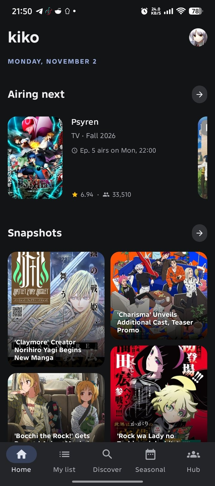
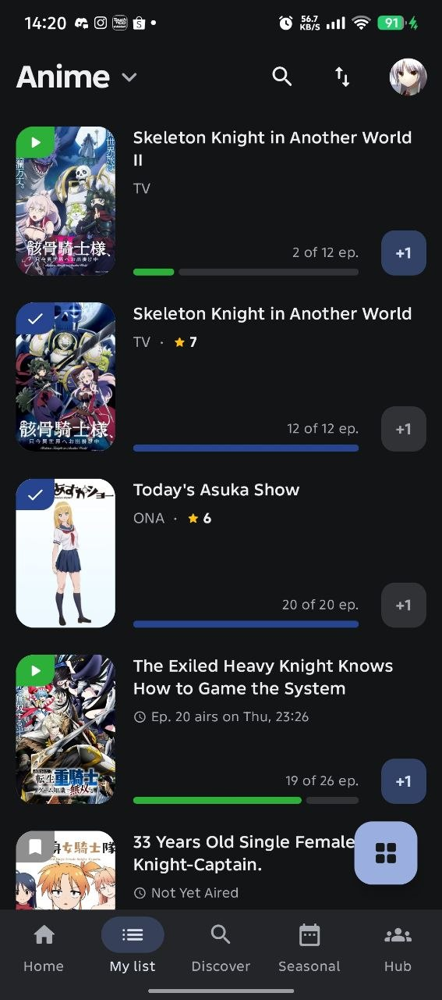
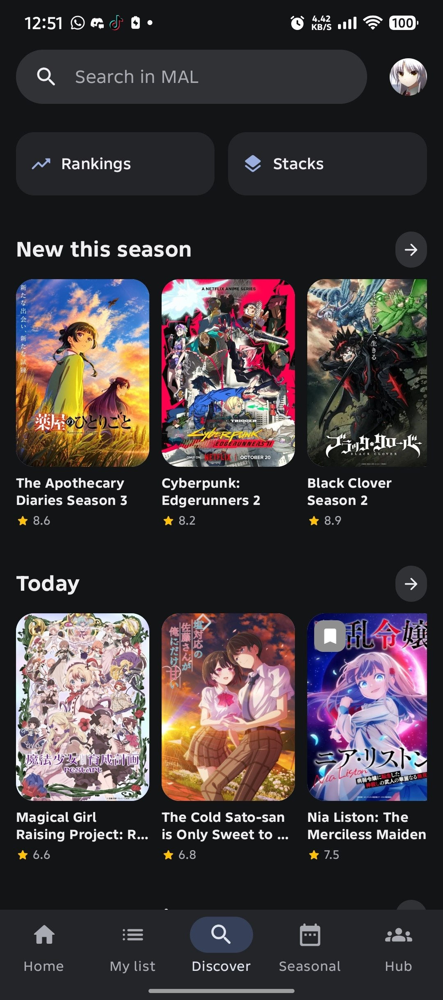
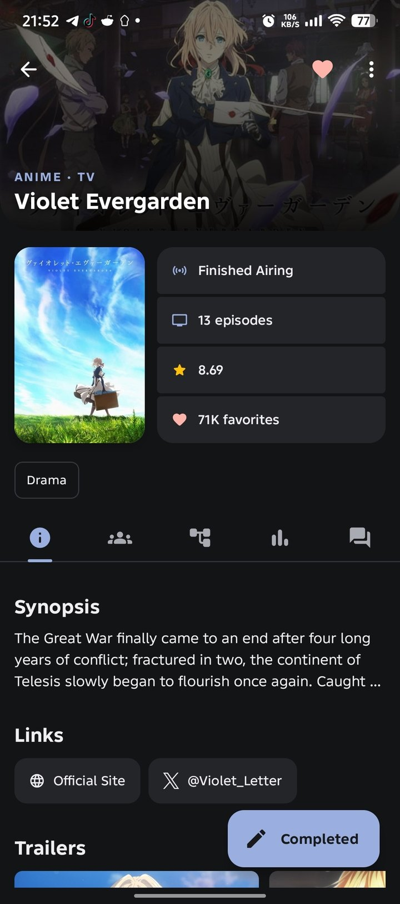
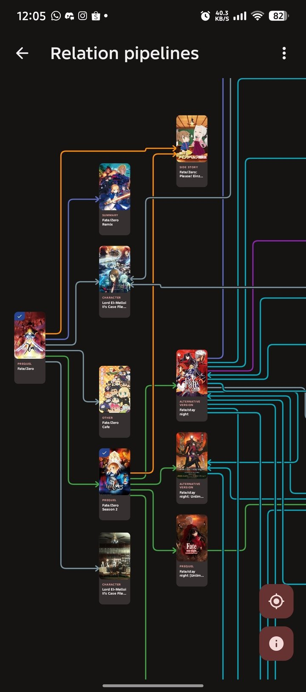
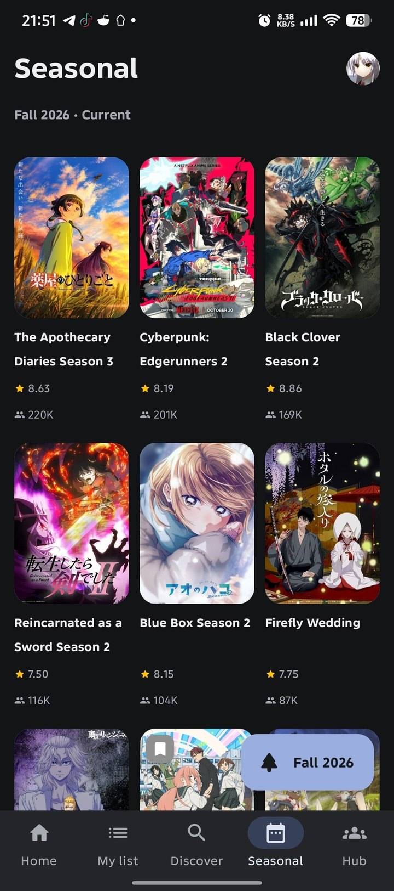
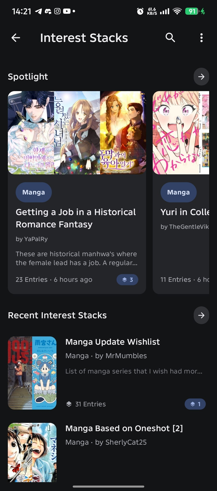
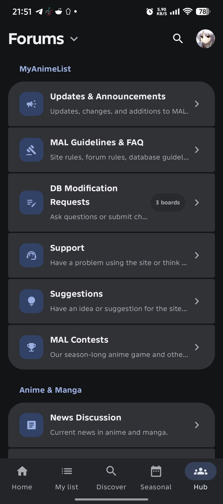
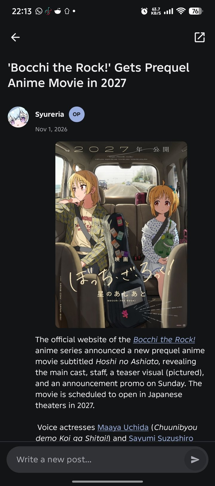
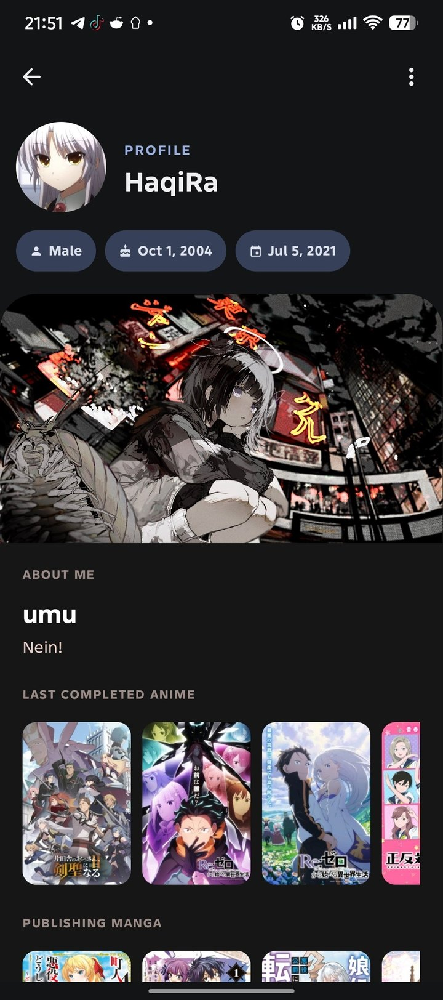

<div align="center">


# Kiko

**Yet Another Unofficial MyAnimeList Client for Android**

Track anime & manga, discover new titles, and stay close to the MyAnimeList community, all in one clean Material 3 app.

<br>

<!-- Row 1: main buttons -->
[](https://github.com/SyHaqi/kiko/releases/latest)
[](https://syhaqi.github.io/kiko/)
[](https://discord.gg/qytyH7efp6)

<!-- Row 2: live stats, pastel palette from the website -->
[](https://github.com/SyHaqi/kiko/releases)
[](https://github.com/SyHaqi/kiko/stargazers)
[](https://github.com/SyHaqi/kiko/issues)

<!-- Row 3: small info pills -->


[](https://github.com/SyHaqi/kiko/releases/latest)
[](https://github.com/SyHaqi/kiko/commits)
[](LICENSE)

</div>

---

## 🖼️ Screenshots

<div align="center">





</div>

<details>
<summary><b>More screenshots</b></summary>
<br>
<div align="center">





</div>
</details>

---

## ✨ Features

- **Home**: airing schedule (times synced via AniList), MAL's latest announcement, forum snapshots and featured articles.
- **My List**: sync your MAL list, filter/sort/search, edit entries, and bump progress with a quick **+1**.
- **Discover**: search anime, manga, characters, people and companies with advanced filters and personalized recommendations.
- **Rankings & Seasonal Charts**: browse by score, popularity, favorites, or by season and year.
- **Title Details**: synopsis, trailers, characters, staff, reviews, recommendations, stats and related entries on one page.
- **Hub**: MAL forums and clubs in a single tab, plus Interest Stacks browsing.
- **Profile & Stats**: OAuth login, history, friends, and activity breakdowns by genre, score, format and year.
- **Appearance**: light/dark/system themes, dynamic or custom colors, AMOLED dark, Romaji/English titles and a list layout (grid or list) that applies app-wide.
- **Updates**: built-in update checker that pulls new versions straight from GitHub Releases.
- **Deep Links**: open MAL anime/manga links directly in Kiko.

---

## 📦 Installation

1. Go to the **[latest release](https://github.com/SyHaqi/kiko/releases/latest)** and download the APK.
2. Open it on your device. Android may ask you to allow installs from your browser or file manager.
3. Launch Kiko and sign in with your MyAnimeList account.

Kiko needs **Android 8.0 (API 26)** or newer. It isn't on Google Play, so after the first install the app tells you when a new release is out.

---

## 🛠️ Building from Source

**Requirements:** Android Studio, JDK 17, Android SDK Platform 37, and a MyAnimeList API client ID.

```bash
git clone https://github.com/SyHaqi/kiko.git
cd kiko
```

Copy `local.properties.example` → `local.properties` and set:

```properties
MAL_CLIENT_ID=YOUR_MYANIMELIST_CLIENT_ID
```

Kiko uses OAuth with the redirect URI `com.kiko.tracker://oauth/callback`. **Do not include a MAL client secret**, only the client ID is needed.

Build:

```bash
./gradlew assembleDebug     # macOS/Linux
gradlew.bat assembleDebug   # Windows
```

APK output: `app/build/outputs/apk/debug/`. Use `assembleRelease` for a minified, shrunk build with the baseline profile applied. Version numbers come from the latest Git tag (e.g. `v2.7.1` → `2.7.1`).

---

## 🧱 Built With

Kotlin · Jetpack Compose · Material 3 · AndroidX · Baseline Profiles · OkHttp · Coil · Jsoup · Kotlin Coroutines · MyAnimeList API · Tenrai API · AniList API

---

## 🌐 Data Sources

Kiko pulls data from **MyAnimeList** (accounts, lists, titles, forums, clubs, stacks), the **Tenrai API** (discovery/search), **AniList** (airing schedule accuracy), and **GitHub Releases** (update checks). Kiko doesn't operate or own these services.

---

## ⚠️ Disclaimer

Kiko is an **unofficial third-party MyAnimeList client**, not affiliated with, sponsored by, or endorsed by MyAnimeList. All MAL trademarks, artwork, and user content belong to their respective owners. Availability may change if MAL or other services update their APIs.

---

## 📄 License

Licensed under **GPL-3.0**, see [`LICENSE`](LICENSE) for full terms. You're free to use, study, modify, and redistribute Kiko's source under the same license. Third-party dependencies and assets may carry their own licenses.

Copyright © 2026 Kiko contributors.

---

## 💬 Community

Questions, feedback, or bug reports? [Open an issue](https://github.com/SyHaqi/kiko/issues) or join the [Discord](https://discord.gg/qytyH7efp6).

<div align="center">

**[🌐 Website](https://syhaqi.github.io/kiko/)** · **[⬇ Download](https://github.com/SyHaqi/kiko/releases/latest)** · **[🐞 Report a bug](https://github.com/SyHaqi/kiko/issues)**

</div>